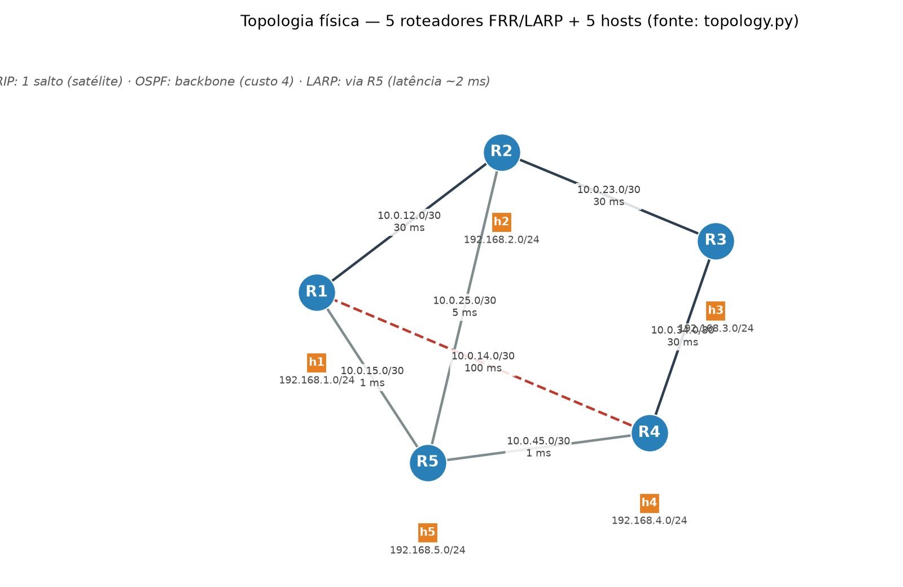
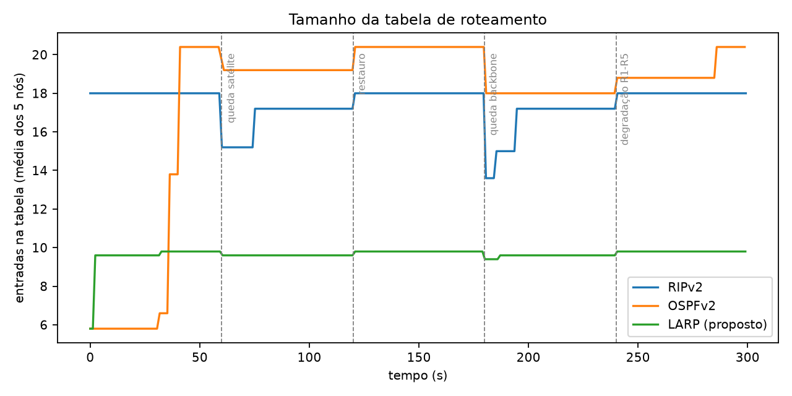
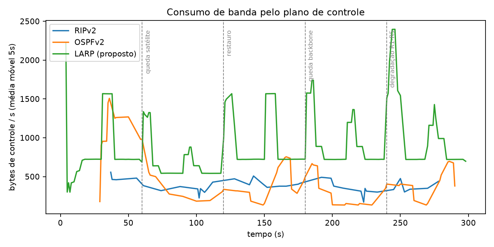
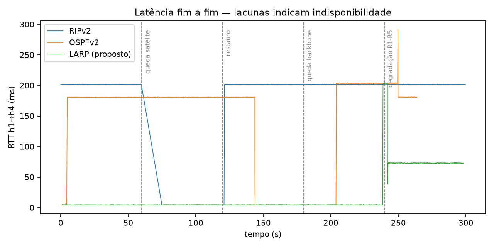
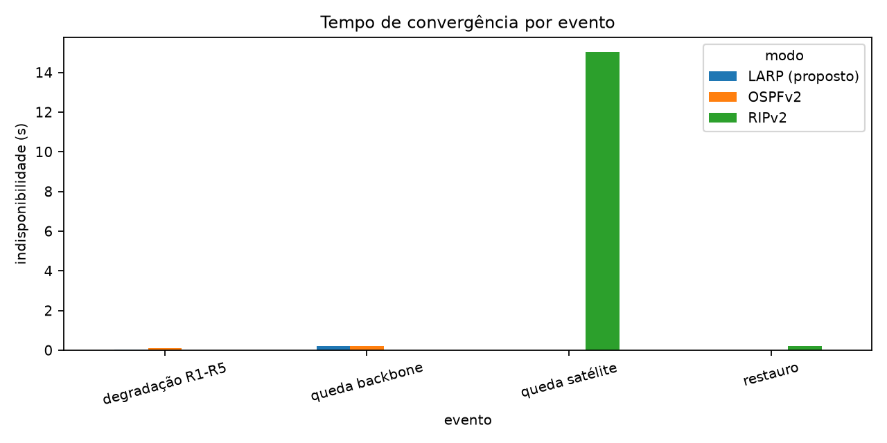

# Roteamento IP — Lab Containerlab/FRR + LARP

Trabalho I — Fundamentos de Sistemas Operacionais (Redes 2) · Unisinos.

Lab de **5 roteadores FRR + 5 hosts Alpine** em Containerlab, com três modos de
roteamento isolados (`rip` | `ospf` | `larp`) sobre a **mesma** topologia física.
RIPv2 e OSPFv2 rodam em daemons reais (FRR 9.1.0, sucessor do Quagga); o **LARP**
(*Latency-Aware Routing Protocol*) é o algoritmo próprio, implementado de verdade
(daemon Python distribuído, métrica ativa de latência, rotas por netlink `proto 200`).

> Design record: `relatorio-trabalho-roteamento.md` (não alterar) ·
> Spec de implementação: `specs/SPEC-roteamento-ip.md` (D14: harness de verificação).

## Status do marco

**M1 – ambiente** ✔ Containerlab 0.79.0 instalado (SUID root), imagem buildada,
lab de 5+5 sobe e se destrói sem resíduo, pings de vizinhança OK.

**M2 – LARP nos 5 nós** ✔ núcleo puro testado (`tests/`), daemon convergindo,
`proto 200` com os 4 stubs remotos por nó, smoke `larp` verde.

**M3 – RIP e OSPF + três caminhos** ✔ `verify.sh rip|ospf|larp` (smoke) verdes;
os três traceroutes de h1→h4 são **diferentes e esperados** (§10; evidência
crua em `docs/m3-caminhos.txt`):

| Modo | Caminho h1→h4 | Por quê |
|---|---|---|
| RIP | `192.168.1.1 → 10.0.14.2 → 192.168.4.10` | 1 salto (satélite), ignora latência |
| OSPF | `192.168.1.1 → 10.0.12.2 → 10.0.23.2 → 10.0.34.2 → 192.168.4.10` | custo estático: backbone (1+1+1+1) |
| LARP | `192.168.1.1 → 10.0.15.2 → 10.0.45.1 → 192.168.4.10` | menor latência medida (~2 ms via R5) |

**M4 – evidência** ✔ `scenario.sh <modo>` FASE=60 (3 execuções de 300 s),
`verify.sh --offline` **verde** (tolerâncias D13), 4 figuras + diagrama em
`figs/`, README completo (este arquivo).

**M5 – artefatos finais** ✔ `results/` (CSVs + `execucao.txt` por modo) e
`figs/` commitados, registro de execução commitado, revisão contra a tabela de
avaliação do §14 (ver fim deste README).

## Pré-requisitos

- **Zorin OS 18.1 / Ubuntu noble** (`UBUNTU_CODENAME=noble`)
- **Docker Engine 29.7.2**, usuário no grupo `docker` — contexto `default`
  (`docker context show`; se estiver `desktop-linux`, rode `docker context use default`)
- **Containerlab 0.79.0** em `~/containerlab/bin` (instalado por `bootstrap.sh`)
- **Python 3.12** com `matplotlib` e `pandas` (para `plot.py`)
- **SUID root** no binário do Containerlab (uma vez; ver "Nota sobre privilégios")

## Roteiro rápido

```bash
# 1. Preparo do host (idempotente; nunca usa sudo)
bash scripts/bootstrap.sh

# 2. Build da imagem única
bash scripts/build.sh

# 3. Subir o lab por modo e conferir o caminho esperado (portão M2/M3)
bash scripts/run.sh rip        # ou ospf / larp
bash scripts/verify.sh rip     # smoke: full-mesh 5×5 + caminho inicial esperado

# 4. Cenário cronometrado (ÚNICA via de coleta — 300 s por modo)
bash scripts/scenario.sh rip
bash scripts/scenario.sh ospf
bash scripts/scenario.sh larp

# 5. Verificação OFFLINE dos resultados + figuras
bash scripts/verify.sh --offline 60
python3 src/plot.py            # 4 figuras comparativas em figs/
python3 src/diagram.py         # diagrama da topologia em figs/diagrama.png
```

O comando do professor é **só isso**: preparar o host (`bootstrap.sh`), buildar
(`build.sh`) e rodar `scenario.sh <modo>` — os resultados saem em `results/<modo>/`
com o registro de execução (`execucao.txt`: modo, versões de docker/containerlab/
python e o commit). Para iterar rápido use fases curtas (`scenario.sh <modo> FASE=15`)
— só `FASE=60` alimenta as figuras e os resultados commitados (D12).

## Topologia e endereçamento



| Enlace | Rede | Banda / Latência | Papel |
|---|---|---|---|
| R1–R2 | 10.0.12.0/30 | 100 mbit / 30 ms | backbone |
| R2–R3 | 10.0.23.0/30 | 100 mbit / 30 ms | backbone |
| R3–R4 | 10.0.34.0/30 | 100 mbit / 30 ms | backbone |
| R1–R5 | 10.0.15.0/30 | 10 mbit / 1 ms | atalho (usado pelo LARP) |
| R4–R5 | 10.0.45.0/30 | 10 mbit / 1 ms | atalho (usado pelo LARP) |
| R2–R5 | 10.0.25.0/30 | 10 mbit / 5 ms | alternativo |
| R1–R4 | 10.0.14.0/30 | **1 mbit / 100 ms** | **satélite** (usado pelo RIP) |

Hosts: `h1..h5` com `192.168.{1..5}.10/24`, gateway `192.168.{1..5}.1` na LAN de
`R1..R5`. Loopbacks `10.255.0.1..5/32`. Tudo declarado em `topology.py` (fonte da
verdade, D3); o manifesto, as configs e o `impair.sh` são **gerados** por
`python3 src/gen_configs.py` — não editar à mão.

## O LARP — Latency-Aware Routing Protocol

**Classificação:** protocolo de estado de enlace, distribuído, com métrica **ativa** de latência.

- **Métrica:** cada roteador envia `HELLO` UDP/5555 a cada 2 s para o outro lado de
  cada enlace `/30`; o vizinho devolve `ECHO` com o timestamp; custo = `max(1, RTT/2)`
  ms, suavizado por EWMA (α=0,3). Anuncia quando o custo varia > 20% (limiar que
  troca precisão por estabilidade numa métrica ruidosa) ou a cada 30 s (refresh).
- **Difusão:** LSA (origem, seq, `vizinho→custo`, stubs próprios) por inundação com
  split-horizon e deduplicação por número de sequência — termina em tempo finito.
- **Seleção:** Dijkstra com desempate determinístico — menor soma de latências;
  empate → menos saltos; empate → menor router-id (todos convergem para a mesma rota).
- **Instalação:** primeiro salto do caminho mínimo para cada stub remoto, instalado
  por `ip route ... proto 200` — derruba/reinstala **só** `proto 200`, sem tocar nas
  conectadas nem nas rotas do zebra.
- **Detecção de falha:** 3 HELLOs perdidos (6 s) declaram o vizinho morto.
- **Honestidade (visível na config):** no modo `larp`, `daemons` tem `ripd=no` e
  `ospfd=no`; o `verify.sh larp` confirma que **nenhum** desses processos roda.
- **Limitações assumidas:** sem autenticação, sem áreas (LSDB O(n²)), sem ECMP;
  só IPv4. Metricamente o lab prova **ordenação e reação**, não precisão absoluta.

## Resultados das 3 execuções (FASE=60, 300 s cada)

Eventos do cenário (idênticos nos três modos): **t=60** cai o satélite R1–R4;
**t=120** restaura o satélite; **t=180** cai o backbone R2–R3; **t=240** restaura o
backbone **e** degrada R1–R5 para 200 ms / 10 kbit. CSVs crus em `results/<modo>/`.



**Tabela (média dos 5 nós):** RIPv2 e OSPFv2 mantêm ~17–18 entradas (cada roteador
anuncia enlaces, LAN e loopback de toda a rede); o LARP fica enxuto (~10 entradas):
só as conectadas + os 4 stubs remotos — ele não troca tabela inteira, apenas estado
de enlace. A queda do satélite (t=60) encolhe momentaneamente a tabela RIP (retira
as rotas via R4); a queda do backbone (t=180) tem efeito similar no OSPF.



**Plano de controle (bytes/s em R1, média móvel 5 s):** RIPv2 envia a tabela a cada
30 s (~0,3 pkt/s — picos periódicos + rajadas nos eventos); OSPF mantém HELLOs de
10 s por vizinho (~1,4 pkt/s, com picos de LSA nos eventos); o LARP é o mais
"barulhento" (~6,7 pkt/s) por causa dos HELLO/ECHO de 2 s — constante, sem picos.
Medido: LARP 160 KB, OSPF 31 KB, RIP 16 KB em 300 s. (O texto do §9.5 do relatório
previa o RIP como o mais alto; o FRR só envia a tabela periódica esparsa — o dado
real está aqui e é o que a apresentação deve mostrar.)



**Latência fim a fim h1→h4:** o RIP navega a ~200 ms sobre o satélite e, quando ele
cai (t=60), fica **15 s sem conectividade** (lacuna visível na série) antes de
reconvergir via R5 (~4,5 ms) — a convergência lenta e visível dos timers RIP. Com o
restauro (t=120) volta aos ~200 ms. O OSPF mantém ~180 ms pelo backbone (3 enlaces
de 30 ms na ida e na volta); na queda do backbone (t=180) migra para R5 **sem perder
um ping** (~4,5 ms) e, após o restauro (t=240), fica ~45 s no R5 degradado (~290 ms)
até a adjacência R2–R3 se refazer (HELLOs de 10 s) e voltar ao backbone (~180 ms).
O LARP vive em ~4,5 ms via R5 indiferente aos eventos 1–3; em t=240 mede o custo de
R1–R5 subir para ~200 ms e **migra sozinho** para o caminho de menor latência
(R1→R2→R5→R4, ~36 ms → RTT ~73 ms) em poucos segundos.



**Indisponibilidade por evento (lacunas do ping):** apenas o RIPv2 perde
conectividade de forma mensurável — **15 s** quando o satélite cai (D13: dezenas de
segundos). OSPF e LARP reconvergem **sem lacuna de ping** (subsegundo): o OSPF
porque detecta a interface down na hora e recalcula; o LARP porque a troca é
dirigida pela métrica (o enlace continua de pé, só lento) — o custo `DEAD_AFTER`
só apareceria numa falha real, que o cenário não causa para ele.

**A asserção-chave do trabalho** (verificada pelo harness): no evento t=240
(degradação de R1–R5 por latência), **só o LARP muda de caminho por causa dela** —
o RIPv2 permanece no satélite (cego à latência) e o OSPF muda apenas pelo *restauro*
do backbone (métrica estática), não pela degradação. Prova em `path.csv` e no
`verify.sh --offline`.

## Como o trabalho foi verificado (D14)

- **Smoke por modo:** `bash scripts/verify.sh <modo>` com o lab de pé — full-mesh
  5×5 entre hosts, caminho inicial de h1→h4 igual ao esperado do modo e, no modo
  `larp`, honestidade (sem ripd/ospfd; `show ip rip`/`show ip ospf` vazios; log do
  daemon com custos medidos). É o portão de M2/M3.
- **Offline (resultados):** `bash scripts/verify.sh --offline 60` — lê os CSVs e
  afirma janelas de indisponibilidade por evento (D13), caminho dominante por janela
  e a distinção dos três caminhos iniciais. Tolerâncias em constantes nomeadas no
  próprio script (calibradas em M4 com a execução real). Roda sem lab.

Divergências empíricas registradas (relatório continua a fonte da verdade da
narrativa; os dados reais mandam no README/figuras):

1. `ping` do Alpine é BusyBox e não tem `-D` — o coletor carimba o timestamp na
   chegada da linha (equivalente para o plotador, que normaliza t−t_min).
2. O RIP do FRR reconverge em **15 s** com *triggered updates* (não nos ~180 s do
   invalid timer); o OSPF em cold-start leva ~40 s para popular tudo (HELLOs de
   10 s) e ~45 s para voltar ao backbone após o restauro.
3. No evento t=240 o LARP migra para **R1→R2→R5→R4 (~36 ms)**, não para o backbone
   (~90 ms) como o relatório previa — a métrica dinâmica encontrou o caminho
   verdadeiramente menor; o essencial (únicos a reagir à latência) é o mesmo.
4. O plano de controle do LARP (HELLO 2 s) é o mais volumoso dos três nos dados
   reais (o §9.5 previa o RIP).

## Estrutura do repositório

```
├── topology.py              # fonte da verdade (topologia + endereçamento)
├── topology.clab.yml        # GERADO por src/gen_configs.py
├── configs/                 # GERADO: rip|ospf|larp/R1..R5/{frr.conf,daemons}
├── src/
│   ├── gen_configs.py       # gerador único (configs + manifesto + impairments)
│   ├── larpd.py             # daemon LARP (núcleo puro + camada de I/O)
│   ├── collect.py           # coletor 4 métricas + registro de execução (D11)
│   ├── plot.py              # 4 figuras comparativas (D12: events de FASE)
│   └── diagram.py           # diagrama da topologia (matplotlib)
├── docker/Dockerfile        # imagem única frr-larp:latest
├── scripts/
│   ├── bootstrap.sh         # preparo idempotente do host (sem sudo)
│   ├── build.sh             # build da imagem
│   ├── run.sh               # sobe o lab por modo (netem fatal desde M2)
│   ├── scenario.sh          # roteiro cronometrado — ÚNICA via de coleta (D12)
│   ├── verify.sh            # harness: smoke por modo + offline (D14)
│   ├── check_pings.sh       # pings de vizinhança (ancestral do verify)
│   └── impair.sh            # GERADO: netem dos enlaces
├── tests/                   # pytest do núcleo puro do LARP (sem Docker/root)
├── docs/m3-caminhos.txt     # evidência crua dos 3 caminhos (M3)
├── results/<modo>/          # table/control/latency/path.csv + execucao.txt (D11)
├── figs/                    # tabela, controle, latencia, convergencia, diagrama
└── specs/  relatorio-*.md   # design record + spec (não alterar)
```

## Nota sobre privilégios

O Containerlab (v0.79.0) exige **root ou SUID** mesmo com o usuário no grupo
`docker` (cria veth no netns do host). Os scripts **nunca** chamam `sudo` (neste
host `sudo` pede senha). Destrave uma vez com:

```bash
sudo chown root:root ~/containerlab/bin/containerlab
sudo chmod u+s ~/containerlab/bin/containerlab
```

Alternativa para a demonstração: `sudo bash scripts/run.sh <modo>` (interativo).
O FRR 9.1.0 exige `CAP_SYS_ADMIN` nos containers (`privs_init` do zebra) — o
gerador emite `cap-add: [NET_ADMIN, NET_RAW, SYS_ADMIN]` no manifesto (D5).

## Vídeo

**Link do vídeo (5–6 min):** *placeholder — gravar com o roteiro do §11 do
relatório* (topologia → run rip/show/traceroute → run ospf/show/traceroute → run
larp/log do daemon/traceroute → teste de falha com ping rodando → os 4 gráficos).

## Mapa dos itens de avaliação (§14)

1. Organização da apresentação (1,0) — roteiro e slides do §11 (montagem manual).
2. Instalar/configurar a plataforma (1,0) — `bootstrap.sh`/`build.sh` + este README.
3. Topologias física e lógica (1,0) — `topology.py`, `figs/diagrama.png`, tabela acima.
4. Algoritmo próprio justificado (1,0) — seção LARP deste README + §8.1 do relatório.
5. Configurar RIP/OSPF e implementar o algoritmo (1,0) — configs FRR geradas + `larpd.py` + isolamento por modo (honestidade verificada).
6. Coletar métricas (1,0) — `collect.py`, 4 métricas, `results/<modo>/` commitado.
7. Comparar com gráficos (1,0) — `figs/*.png` + análise acima.
8. Vídeo (1,0) — sem link ainda (placeholder).
9. Apresentação e demonstração (1,0) — roteiro do §11.
10. Respeito ao tempo (1,0) — ensaio cronometrado (manual).